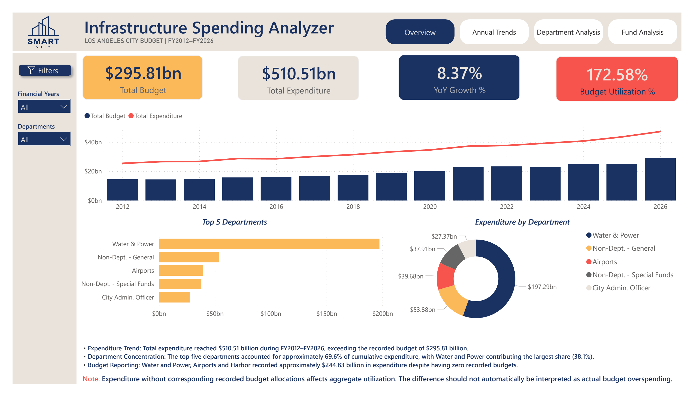
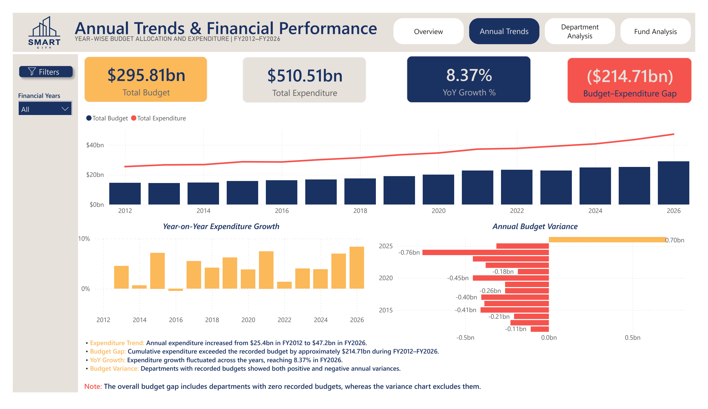
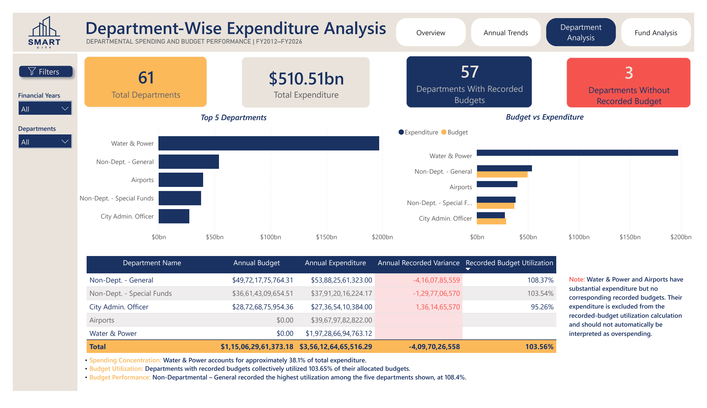
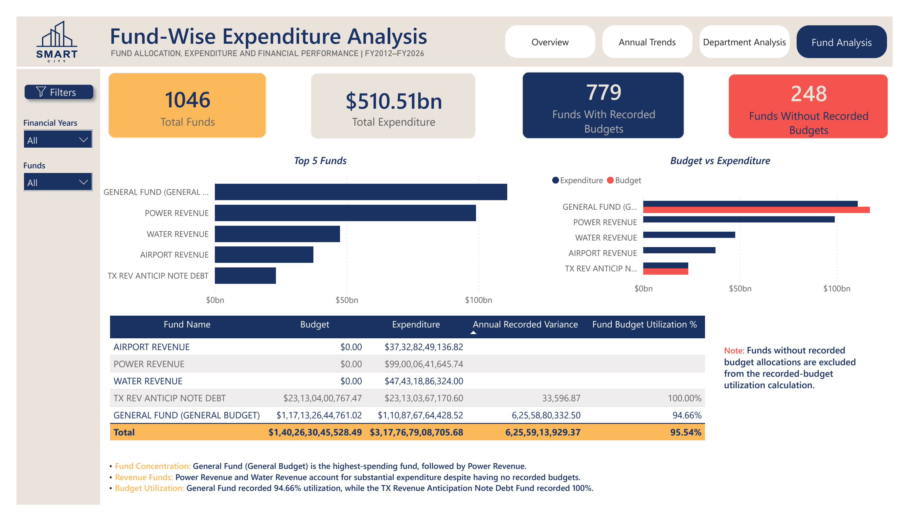

# Smart City Infrastructure Spending Analyzer

An end-to-end data analytics project focused on analysing municipal infrastructure budgets, expenditure patterns, departmental spending and fund-wise financial performance using **Python, MySQL and Power BI**.

The project uses the City of Los Angeles Budget and Expenditures dataset to explore how public funds are allocated and spent, identify spending patterns, and evaluate financial performance across departments and funds.

---

## Project Overview

Public infrastructure spending involves large financial allocations across multiple departments and funds. Analysing these expenditures helps identify spending trends, understand budget utilisation and highlight areas requiring further financial scrutiny.

This project follows an end-to-end data analytics workflow, starting with raw data profiling and cleaning, followed by feature engineering, exploratory data analysis, SQL-based analysis and interactive dashboard development.

**Analysis Period:** FY2012–FY2026

**Dataset:** Los Angeles City Budget and Expenditures

---

## Dashboard Preview

### Executive Summary



### Annual Trends & Financial Performance



### Department-Wise Expenditure Analysis



### Fund-Wise Expenditure Analysis



The interactive Power BI report is also included in the `powerbi` folder, where available.

---

## Tools & Technologies

| Tool | Purpose |
|---|---|
| Python | Data cleaning, transformation and exploratory data analysis |
| Pandas & NumPy | Data manipulation and feature engineering |
| Matplotlib | Data visualisation |
| MySQL | Database management and analytical queries |
| Power BI | Interactive dashboard development |
| DAX | Measures and financial performance calculations |
| Power Query | Data preparation and modelling |

---

## Project Workflow

### 1. Data Profiling and Cleaning
- Examined the raw dataset to understand its structure, columns and data types.
- Identified missing values, duplicate records and data inconsistencies.
- Converted financial columns into appropriate numeric formats.
- Prepared the cleaned dataset for further analysis.

### 2. Feature Engineering
Created additional analytical fields to evaluate financial performance, including:

- Budget Variance
- Budget Utilisation Percentage
- Remaining Budget
- Total Committed Expenditure
- Calculated Budget
- Budget Status

### 3. Exploratory Data Analysis (EDA)
Performed exploratory analysis to understand:

- Annual expenditure trends.
- Department-wise expenditure distribution.
- Fund-wise expenditure patterns.
- Budget allocation versus actual expenditure.
- Departmental budget utilisation.
- Expenditure without corresponding recorded budget allocations.

### 4. SQL Analysis
Imported the processed dataset into MySQL and performed analytical queries using SQL.

Created analytical views covering:

- Annual expenditure.
- Department-wise expenditure.
- Fund-wise expenditure.
- Department budget utilisation.
- Annual department expenditure.
- Annual fund expenditure.
- Annual budget variance.

### 5. Power BI Dashboard
Developed a four-page dashboard to present the financial analysis:

**Page 1 – Executive Overview**
- Overall budget and expenditure KPIs.
- Annual financial performance.
- Top five departments by expenditure.
- Department-wise expenditure distribution.
- Key financial insights.

**Page 2 – Annual Trends & Financial Performance**
- Annual budget versus expenditure.
- Year-on-year expenditure growth.
- Annual budget variance.
- Financial performance trends from FY2012 to FY2026.

**Page 3 – Department-Wise Expenditure Analysis**
- Departmental expenditure comparisons.
- Budget versus expenditure by department.
- Department-level financial summary.
- Recorded budget utilisation.

**Page 4 – Fund-Wise Expenditure Analysis**
- Fund-wise expenditure comparisons.
- Budget versus expenditure by fund.
- Fund expenditure distribution.
- Fund-level financial summary.

---

## Key Findings

The following findings are based on the FY2012–FY2026 analysis.

- **Overall Expenditure:** Total expenditure reached approximately $510.51 billion against a recorded budget of $295.81 billion.
- **Department Concentration:** The top five departments accounted for approximately 69.6% of cumulative expenditure.
- **Water and Power:** This department contributed approximately 38.1% of total expenditure.
- **Annual Growth:** Expenditure increased from approximately $25.4 billion in FY2012 to $47.2 billion in FY2026, with year-on-year growth of 8.37% in FY2026.
- **Department Budget Utilisation:** Departments with recorded budgets collectively utilised approximately 103.65% of their allocated budgets.
- **Fund Analysis:** General Fund (General Budget) recorded approximately 94.66% budget utilisation.

### Important Data Observation

Certain departments and funds, including Water and Power, Airports, Power Revenue and Water Revenue, reported substantial expenditure without corresponding recorded budget allocations in the dataset.

This affects aggregate budget utilisation and the overall budget-expenditure difference. Such differences should not automatically be interpreted as actual budget overspending.

---

## Project Structure

```text
Smart-City-Infrastructure-Spending-Analyzer/
│
├── data/
│   ├── raw/
│   ├── cleaned/
│   └── processed/
│
├── scripts/
│   ├── 01_data_profiling.py
│   ├── 02_data_cleaning.py
│   ├── 03_feature_engineering.py
│   ├── 04_eda.py
│   └── 05_visualization.py
│
├── sql/
│   ├── 04_expenditure_analysis.sql
│   ├── 05_department_analysis.sql
│   ├── 06_fund_analysis.sql
│   ├── 07_budget_utilization.sql
│   ├── 08_advanced_analysis.sql
│   └── 09_analytical_views.sql
│
├── reports/
│   ├── charts/
│   └── Smart_City_Infrastructure_Dashboard.pdf
│
├── powerbi/
│   └── Smart_City_Infrastructure_Dashboard.pbix
│
├── requirements.txt
├── .gitignore
└── README.md
```

---

## How to Run the Project

1. Clone or download this repository.
2. Install the required Python libraries:

```bash
pip install -r requirements.txt
```

3. Run the Python scripts in sequence, beginning with data profiling and cleaning.
4. Set up MySQL and import the processed dataset.
5. Execute the SQL analysis scripts to generate the analytical queries and views.
6. Open the Power BI file to explore the dashboard.

*Note: Update database connection settings according to your local MySQL configuration before running the SQL-connected workflow.*

---

## Conclusion

This project demonstrates an end-to-end approach to data analytics, combining Python-based data preparation, SQL-based financial analysis and Power BI visualisation.

It highlights the importance of data quality, financial interpretation and interactive reporting when analysing large-scale public expenditure datasets.
